## Variants
Positions where a sequenced sample differs from the reference genome

<div class="r-stretch" style="display:flex; align-items:center; justify-content:center;">
<svg viewBox="0 0 900 210" xmlns="http://www.w3.org/2000/svg" style="width:100%; height:100%;">
  <defs>
    <marker id="arrowhead" markerWidth="10" markerHeight="7" refX="9" refY="3.5" orient="auto">
      <polygon points="0 0, 10 3.5, 0 7" fill="rgba(255,255,255,0.6)"/>
    </marker>
  </defs>
  <rect x="20" y="70" width="190" height="70" rx="10" fill="#0072B2"/>
  <text x="115" y="101" text-anchor="middle" fill="white" font-size="22" font-weight="700" font-family="Nunito,sans-serif">FASTQ</text>
  <text x="115" y="124" text-anchor="middle" fill="rgba(255,255,255,0.85)" font-size="13" font-family="Nunito,sans-serif">Raw sequencing reads</text>
  <text x="115" y="162" text-anchor="middle" fill="rgba(255,255,255,0.5)" font-size="12" font-family="Nunito,sans-serif">~150 bp reads · ~5–15 GB/sample (exome)</text>
  <line x1="210" y1="105" x2="338" y2="105" stroke="rgba(255,255,255,0.5)" stroke-width="2.5" marker-end="url(#arrowhead)"/>
  <text x="274" y="92" text-anchor="middle" fill="rgba(255,255,255,0.85)" font-size="13" font-weight="600" font-family="Nunito,sans-serif">Alignment</text>
  <text x="274" y="124" text-anchor="middle" fill="rgba(255,255,255,0.5)" font-size="11" font-family="Nunito,sans-serif">BWA-MEM</text>
  <rect x="340" y="70" width="200" height="70" rx="10" fill="#E69F00"/>
  <text x="440" y="101" text-anchor="middle" fill="white" font-size="22" font-weight="700" font-family="Nunito,sans-serif">BAM</text>
  <text x="440" y="124" text-anchor="middle" fill="rgba(255,255,255,0.85)" font-size="13" font-family="Nunito,sans-serif">Reads mapped to reference</text>
  <text x="440" y="162" text-anchor="middle" fill="rgba(255,255,255,0.5)" font-size="12" font-family="Nunito,sans-serif">Sorted &amp; indexed · ~1–4 GB/sample (exome)</text>
  <line x1="540" y1="105" x2="658" y2="105" stroke="rgba(255,255,255,0.5)" stroke-width="2.5" marker-end="url(#arrowhead)"/>
  <text x="599" y="92" text-anchor="middle" fill="rgba(255,255,255,0.85)" font-size="13" font-weight="600" font-family="Nunito,sans-serif">Variant Calling</text>
  <text x="599" y="124" text-anchor="middle" fill="rgba(255,255,255,0.5)" font-size="11" font-family="Nunito,sans-serif">GATK · DeepVariant</text>
  <rect x="660" y="70" width="210" height="70" rx="10" fill="#009E73"/>
  <text x="765" y="101" text-anchor="middle" fill="white" font-size="22" font-weight="700" font-family="Nunito,sans-serif">VCF</text>
  <text x="765" y="124" text-anchor="middle" fill="rgba(255,255,255,0.85)" font-size="13" font-family="Nunito,sans-serif">Variants vs. reference</text>
  <text x="765" y="162" text-anchor="middle" fill="rgba(255,255,255,0.5)" font-size="12" font-family="Nunito,sans-serif">SNPs · indels · SVs</text>
</svg>
</div>

The VCF *at this stage* records the *what* — not *what it does*, how *common* it is, or whether it causes disease

Note: A variant is any position where an individual's sequence differs from the reference genome. Variants range from single nucleotide polymorphisms (SNPs — a single base change) to short insertions and deletions (indels) to larger structural variants (SVs). This lecture focuses on SNPs and indels, which are the most reliably detected by short-read sequencing. The pipeline takes raw reads (FASTQ), aligns them with BWA-MEM or STAR to produce a sorted BAM, then calls variants with GATK HaplotypeCaller or DeepVariant. A typical exome generates ~50,000–100,000 variant calls before filtering; a whole genome generates ~4–5 million. The VCF at this stage records the what — chromosome, position, REF allele, ALT allele, genotype, quality — but not the biological significance. Annotation is the layer that answers "so what?"

---

<!-- .slide: style="font-size:0.78em" -->
## VCF Files from Variant Calling
Quality-focused — biological effect is absent

<div class="r-stretch" style="display:flex; flex-direction:column; gap:0.5em; justify-content:center; text-align:left;">

<div style="font-family:'Consolas','Courier New',monospace; color:#555; font-size:0.72em; line-height:1.55;">
  <div>##fileformat=VCFv4.2</div>
  <div>##reference=GRCh38</div>
  <div>##FILTER=&lt;ID=PASS,Description="All filters passed"&gt;</div>
  <div>##INFO=&lt;ID=DP,Type=Integer,Description="Read Depth"&gt;</div>
  <div>##FORMAT=&lt;ID=GT,Description="Genotype"&gt;</div>
  <div>##FORMAT=&lt;ID=GQ,Description="Genotype Quality"&gt;</div>
</div>

<table style="width:100%; border-collapse:collapse; font-family:'Consolas','Courier New',monospace; font-size:0.78em; background:rgba(0,0,0,0.3); border-radius:6px; overflow:hidden; text-align:left;">
  <thead>
    <tr style="background:rgba(255,255,255,0.07);">
      <th style="padding:0.3em 0.4em; text-align:left; color:#6ba3d6; font-weight:700;">#CHROM</th>
      <th style="padding:0.3em 0.4em; text-align:right; color:#6ba3d6; font-weight:700;">POS</th>
      <th style="padding:0.3em 0.4em; text-align:left; color:#555;">ID</th>
      <th style="padding:0.3em 0.4em; text-align:left; color:#6ecfb0; font-weight:700;">REF</th>
      <th style="padding:0.3em 0.4em; text-align:left; color:#6ecfb0; font-weight:700;">ALT</th>
      <th style="padding:0.3em 0.4em; text-align:right; color:#f0c040;">QUAL</th>
      <th style="padding:0.3em 0.4em; text-align:left; color:#f0c040;">FILTER</th>
      <th style="padding:0.3em 0.4em; text-align:left; color:#f0c040;">INFO</th>
      <th style="padding:0.3em 0.4em; text-align:left; color:#aaa;">FORMAT</th>
      <th style="padding:0.3em 0.4em; text-align:left; color:#aaa;">SAMPLE</th>
    </tr>
  </thead>
  <tbody>
    <tr>
      <td style="padding:0.3em 0.4em; color:#aaddff;">chr1</td>
      <td style="padding:0.3em 0.4em; text-align:right; color:#aaddff;">925952</td>
      <td style="padding:0.3em 0.4em; color:#555;">.</td>
      <td style="padding:0.3em 0.4em; color:#aaffcc;">G</td>
      <td style="padding:0.3em 0.4em; color:#ffaaaa;">A</td>
      <td style="padding:0.3em 0.4em; text-align:right; color:#ccc;">40</td>
      <td style="padding:0.3em 0.4em; color:#6ecfb0;">PASS</td>
      <td style="padding:0.3em 0.4em; color:#ccc; white-space:nowrap;">DP=32;AF=0.45</td>
      <td style="padding:0.3em 0.4em; color:#aaa;">GT:DP:GQ</td>
      <td style="padding:0.3em 0.4em; color:#f0c040;">0/1:32:45</td>
    </tr>
    <tr style="background:rgba(255,255,255,0.03);">
      <td style="padding:0.3em 0.4em; color:#aaddff;">chr7</td>
      <td style="padding:0.3em 0.4em; text-align:right; color:#aaddff;">117548628</td>
      <td style="padding:0.3em 0.4em; color:#555;">.</td>
      <td style="padding:0.3em 0.4em; color:#aaffcc;">C</td>
      <td style="padding:0.3em 0.4em; color:#ffaaaa;">T</td>
      <td style="padding:0.3em 0.4em; text-align:right; color:#ccc;">99</td>
      <td style="padding:0.3em 0.4em; color:#6ecfb0;">PASS</td>
      <td style="padding:0.3em 0.4em; color:#ccc; white-space:nowrap;">DP=58;AF=0.97</td>
      <td style="padding:0.3em 0.4em; color:#aaa;">GT:DP:GQ</td>
      <td style="padding:0.3em 0.4em; color:#f0c040;">1/1:58:99</td>
    </tr>
    <tr>
      <td style="padding:0.3em 0.4em; color:#aaddff;">chrX</td>
      <td style="padding:0.3em 0.4em; text-align:right; color:#aaddff;">154534110</td>
      <td style="padding:0.3em 0.4em; color:#555;">.</td>
      <td style="padding:0.3em 0.4em; color:#aaffcc;">A</td>
      <td style="padding:0.3em 0.4em; color:#ffaaaa;">G</td>
      <td style="padding:0.3em 0.4em; text-align:right; color:#ccc;">28</td>
      <td style="padding:0.3em 0.4em; color:#f0a040;">LowQual</td>
      <td style="padding:0.3em 0.4em; color:#ccc; white-space:nowrap;">DP=12;AF=0.42</td>
      <td style="padding:0.3em 0.4em; color:#aaa;">GT:DP:GQ</td>
      <td style="padding:0.3em 0.4em; color:#f0c040;">0/1:12:30</td>
    </tr>
  </tbody>
</table>

<div style="display:flex; gap:1.5em; justify-content:center; font-size:0.75em; flex-wrap:wrap;">
  <span><span style="color:#6ba3d6;">■</span> Coordinates</span>
  <span><span style="color:#6ecfb0;">■</span> Alleles</span>
  <span><span style="color:#f0c040;">■</span> Quality / filter / genotype</span>
  <span style="opacity:0.4; font-style:italic;">No gene · No consequence · No population AF</span>
</div>

</div>

Note: The VCF format itself is flexible — the same format is used both by variant callers and by annotation tools. The distinction is in the content. A VCF straight out of GATK or DeepVariant is filled with quality metrics: QUAL (Phred-scaled call confidence), FILTER (PASS or a failure reason), DP (read depth), GQ (genotype quality), and population-level counts like AC/AN. These tell you how confident the caller is that the variant is real — they say nothing about biology. Key columns: CHROM/POS = genomic coordinate; REF/ALT = reference and alternate alleles; GT = genotype (0/0 homRef, 0/1 het, 1/1 homAlt); DP = read depth; GQ = genotype quality. Row 1 is a moderate-quality heterozygous SNV (QUAL=40, GT=0/1); row 2 is a high-quality homozygous alt call (QUAL=99, GT=1/1); row 3 has LowQual FILTER because depth DP=12 is below standard thresholds (typically DP ≥ 20). BCF is the binary-compressed equivalent of VCF — same information, smaller and faster to parse. What is missing from the variant-calling VCF: which gene the variant falls in, what it does to the protein, how common it is in the population, and whether it has been seen in disease. Annotation adds all of this — and outputs an annotated VCF with new INFO fields populated.

---

<!-- .slide: style="font-size:0.8em" -->
## Annotations Provide Context for Interpretation

| Category | Question answered | Examples |
|---|---|---|
| **Population frequency** | How common is this variant? | gnomAD, dbSNP |
| **Functional consequence** | What does it do to the transcript? | VEP, ANNOVAR, SnpEff |
| **Pathogenicity prediction** | Is it likely damaging? | CADD, REVEL, AlphaMissense |
| **Disease association** | Has it been seen in disease? | ClinVar, OMIM |
| **Genomic context** | Where does it fall? | ENCODE, Pfam, UCSC |

<div style="display:flex; gap:0.8em; align-items:center; margin-top:0.5em; font-size:0.83em;">
  <code style="flex:1; background:rgba(255,255,255,0.07); padding:0.3em 0.5em; border-radius:4px; color:rgba(255,255,255,0.55); white-space:nowrap;">chr17:43057094 G&gt;A</code>
  <span style="color:rgba(255,255,255,0.3); font-size:1.3em; flex:0 0 auto;">→</span>
  <span style="flex:3; background:rgba(0,114,178,0.11); padding:0.3em 0.5em; border-radius:4px;"><em>BRCA1</em> · stop_gained · AF &lt; 10⁻⁵ · ClinVar: Pathogenic · CADD 48</span>
</div>

Note: These five categories form the backbone of variant interpretation. Population frequency — gnomAD is now the gold standard (730,000+ exomes in v4) — answers whether the variant is common enough to be benign by chance. Functional consequence tools (VEP, ANNOVAR, SnpEff) predict the molecular effect on each overlapping transcript using gene models. Pathogenicity predictors aggregate conservation, structure, and population data into a score; CADD and REVEL are widely used ensemble scores, AlphaMissense leverages AlphaFold protein structure. Disease databases record prior clinical observations — ClinVar is freely accessible, HGMD is largely commercial. Genomic context tells you whether the variant falls in a conserved region, a protein domain, or a regulatory element. A variant annotation pipeline queries all five categories simultaneously, and the ACMG/AMP framework formalizes how to combine evidence across them — that's coming later in this lecture.

---

<!-- .slide: style="font-size:0.78em" -->
## Key Population Database: gnomAD

The **Genome Aggregation Database** — the reference for population allele frequencies

| Version | Exomes | Genomes | Populations |
|---|---|---|---|
| ExAC (2016) | 60,706 | — | 7 |
| gnomAD v4 (2023) | 730,947 | 76,215 | 43 |

<br>

- **AF < 0.001** — conventional threshold for rare variants; some studies use stricter AF < 0.0001
- **Population-stratified AF** — a variant rare globally may be enriched in one ancestry
- **Constraint metrics** — pLI (LoF intolerance) and missense Z-score per gene
- **Not disease-ascertained** — excludes severe pediatric disease; valid population reference

Note: gnomAD was built by aggregating sequencing data from many independent research studies — it is not a single cohort. Individuals with severe childhood-onset disease were removed, making the allele frequencies a reasonable proxy for what a healthy general population looks like. A key principle: a variant found at appreciable frequency in gnomAD (e.g., AF > 0.1%) is almost certainly not the cause of a rare Mendelian disease — if it were, the disease would be equally common. Conversely, absent from gnomAD does not mean pathogenic; many benign variants are too rare to appear even in 700,000 exomes. Population-stratified frequencies are critical — always check the ancestry-specific AF, not just the global AF. gnomAD also reports constraint metrics: pLI (probability of LoF intolerance) close to 1 means the gene is under strong purifying selection against loss-of-function; missense Z-score quantifies depletion of missense variants relative to expectation. Both are used throughout this lecture for variant prioritization and as weights in gene-based tests. Access at gnomad.broadinstitute.org — the browser is freely available.

---

<!-- .slide: style="font-size:0.85em" -->
## Case Study: Loss of Function

A single SNP can convert an amino acid codon to a **premature stop codon**:

|  | Codon 1 | Codon 2 | Codon 3 |
|--|--|--|--|
| Normal | `ctg` (L) | `cag` (Q) | `act` (T) |
| Mutated | `ctg` (L) | **`tag`** (Stop) | `act` (T) |

- **LoF classes:** stop-gain, frameshift (indel), splice-site disruption
- **NMD:** transcripts with premature stops are often degraded — no truncated protein produced
- **Most LoF is tolerated** — ~100 high-confidence LoF variants per genome; most affect non-essential or recessive genes

Note: Loss-of-function variants disrupt the normal protein product. Stop-gain mutations introduce a premature stop codon; frameshifts from insertions or deletions alter the reading frame, usually producing a nonsense downstream stop; splice-site variants disrupt the canonical GT-AG splice signals and cause exon skipping or intron retention. Nonsense-mediated mRNA decay (NMD) is a cellular surveillance mechanism that degrades transcripts with premature termination codons more than ~50-55 nt upstream of the last exon-exon junction — so the cell often produces no protein at all, not just a truncated one. Whether a LoF variant causes disease depends on the gene: haploinsufficient genes (BRCA1, TP53) are intolerant of losing one copy; recessive genes require both copies to be disrupted. A typical genome has ~281 predicted LoF variants before quality filtering and ~100 high-confidence ones after — most are tolerated. This gap between raw predictions and true LoF calls is why annotation quality matters.

---

## Same Variant, Different Consequence — Depends on the Transcript

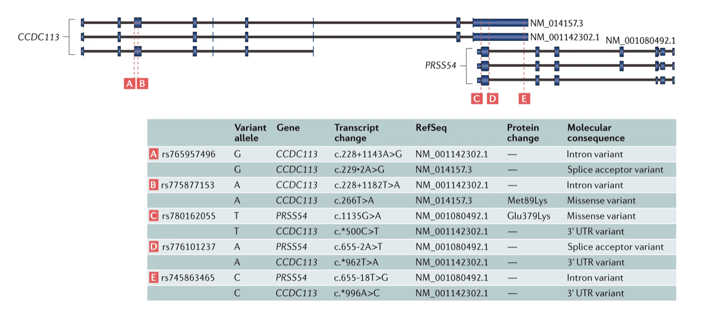

<small>PMID: 28804138</small>

Note: Two genes — CCDC113 and PRSS54 — overlap on opposite strands of the same genomic region, and each has multiple transcripts. The table shows five variants (A–E) and how each gets a different molecular consequence depending on which gene and transcript is used. A striking example: rs780162055 (variant C) is a missense variant (Glu379Lys) for PRSS54 but a 3′ UTR variant for CCDC113 — the same base change, two completely different biological interpretations. Similarly, rs775877153 (variant B) is an intron variant in one CCDC113 transcript but a missense variant (Met89Lys) in another. This is not a corner case — it is the rule for any gene with multiple transcripts, which is the majority of protein-coding genes. The practical consequence: which transcript you annotate against determines what you call the variant. This ambiguity motivated the development of MANE Select (a joint NCBI/EBI standard that designates one representative transcript per gene), which is now the default in gnomAD v4 and ClinVar and will be discussed in the next few slides.

---

<!-- .slide: style="font-size:0.82em" -->
## Tools for Annotating Variant Consequences

Given a VCF, each tool reports the consequence on every overlapping transcript:

| Tool | Default gene models | Key strength |
|---|---|---|
| **VEP** | Ensembl / GENCODE | Most features; plugin system; MANE Select support |
| **ANNOVAR** | RefSeq *(configurable)* | Fast; flexible database system |
| **SnpEff** | Ensembl / RefSeq | Lightweight; easy custom databases |

All three assign a **Sequence Ontology term** per transcript — `stop_gained`, `missense_variant`, `splice_donor_variant`, etc.

The choice of gene model and transcript determines what consequence you call

Note: All three tools work the same way conceptually: given a genomic coordinate and allele, they look up which transcripts overlap, determine the position of the variant relative to each transcript's exon/intron structure, and assign a Sequence Ontology consequence term. VEP is the most feature-rich — it supports hundreds of plugins (CADD, SpliceAI, LOFTEE, AlphaMissense) and is the standard in clinical genomics. ANNOVAR is extremely fast and has a well-curated database system popular in research pipelines; it uses RefSeq by default but can use Ensembl. SnpEff is lightweight and straightforward to set up with custom genomes. The critical point: the consequence depends entirely on which transcript is used. VEP now supports MANE Select as the primary transcript — this is the recommended default and should be used unless there is a specific reason to use a different transcript.

---

<!-- .slide: style="font-size:0.85em" -->
## Variant Effect Predictor (VEP)

<svg viewBox="0 0 820 220" xmlns="http://www.w3.org/2000/svg" style="width:100%;max-height:180px;display:block;margin:0 auto 0.4em">
  <defs>
    <marker id="arr" markerWidth="8" markerHeight="8" refX="7" refY="3" orient="auto"><path d="M0,0 L0,6 L8,3 z" fill="#aaa"/></marker>
  </defs>
  <!-- Input -->
  <rect x="10" y="60" width="130" height="100" rx="8" fill="#1e3a5f" stroke="#0072B2" stroke-width="1.5"/>
  <text x="75" y="85" text-anchor="middle" font-size="12" fill="#fff" font-weight="600">Input VCF</text>
  <text x="75" y="103" text-anchor="middle" font-size="10" fill="#aad4f5">chr1  925952  .  G  A</text>
  <text x="75" y="118" text-anchor="middle" font-size="10" fill="#aad4f5">chr2  234567  .  C  T</text>
  <text x="75" y="133" text-anchor="middle" font-size="10" fill="#aad4f5">chrX  543210  .  A  G</text>
  <text x="75" y="148" text-anchor="middle" font-size="10" fill="#888">…</text>
  <!-- Arrow 1 -->
  <line x1="142" y1="110" x2="192" y2="110" stroke="#aaa" stroke-width="1.5" marker-end="url(#arr)"/>
  <!-- VEP box -->
  <rect x="195" y="20" width="200" height="180" rx="8" fill="#1a2a1a" stroke="#009E73" stroke-width="1.5"/>
  <text x="295" y="44" text-anchor="middle" font-size="13" fill="#fff" font-weight="700">VEP</text>
  <text x="295" y="60" text-anchor="middle" font-size="10" fill="#6ecfb0">Ensembl Variant Effect Predictor</text>
  <!-- Ensembl transcripts -->
  <rect x="212" y="68" width="166" height="36" rx="5" fill="#0d1f0d" stroke="#009E73" stroke-width="1"/>
  <text x="295" y="83" text-anchor="middle" font-size="10" fill="#6ecfb0" font-weight="600">Ensembl / GENCODE transcripts</text>
  <text x="295" y="97" text-anchor="middle" font-size="9" fill="#999">Maps variant → transcript overlap</text>
  <!-- Plugins label -->
  <text x="295" y="120" text-anchor="middle" font-size="10" fill="#E69F00" font-weight="600">Plugins</text>
  <!-- Plugin pills -->
  <rect x="213" y="126" width="50" height="18" rx="4" fill="#2a1f00" stroke="#E69F00" stroke-width="0.8"/>
  <text x="238" y="139" text-anchor="middle" font-size="9" fill="#E69F00">CADD</text>
  <rect x="270" y="126" width="55" height="18" rx="4" fill="#2a1f00" stroke="#E69F00" stroke-width="0.8"/>
  <text x="297" y="139" text-anchor="middle" font-size="9" fill="#E69F00">LOFTEE</text>
  <rect x="332" y="126" width="50" height="18" rx="4" fill="#2a1f00" stroke="#E69F00" stroke-width="0.8"/>
  <text x="357" y="139" text-anchor="middle" font-size="9" fill="#E69F00">SpliceAI</text>
  <!-- Run modes -->
  <rect x="212" y="152" width="166" height="36" rx="5" fill="#0d1f0d" stroke="#009E73" stroke-width="1"/>
  <text x="295" y="167" text-anchor="middle" font-size="10" fill="#6ecfb0" font-weight="600">Web · Command-line · API</text>
  <text x="295" y="181" text-anchor="middle" font-size="9" fill="#999">GRCh38 / GRCh37 supported</text>
  <!-- Arrow 2 -->
  <line x1="397" y1="110" x2="447" y2="110" stroke="#aaa" stroke-width="1.5" marker-end="url(#arr)"/>
  <!-- Output -->
  <rect x="450" y="20" width="360" height="180" rx="8" fill="#1e2a3a" stroke="#0072B2" stroke-width="1.5"/>
  <text x="630" y="44" text-anchor="middle" font-size="12" fill="#fff" font-weight="600">Per-transcript output</text>
  <!-- Output table header -->
  <rect x="462" y="52" width="336" height="18" rx="3" fill="#0d1e30"/>
  <text x="510" y="64" text-anchor="middle" font-size="9" fill="#6ba3d6" font-weight="600">Consequence</text>
  <text x="610" y="64" text-anchor="middle" font-size="9" fill="#6ba3d6" font-weight="600">HGVS</text>
  <text x="730" y="64" text-anchor="middle" font-size="9" fill="#6ba3d6" font-weight="600">gnomAD AF / Score</text>
  <!-- Row 1 -->
  <text x="510" y="82" text-anchor="middle" font-size="9" fill="#f4c542">stop_gained</text>
  <text x="610" y="82" text-anchor="middle" font-size="9" fill="#ccc">p.Arg143Ter</text>
  <text x="730" y="82" text-anchor="middle" font-size="9" fill="#ccc">4×10⁻⁶ / CADD 38</text>
  <!-- Row 2 -->
  <text x="510" y="98" text-anchor="middle" font-size="9" fill="#ccc">synonymous_variant</text>
  <text x="610" y="98" text-anchor="middle" font-size="9" fill="#ccc">p.Asp133=</text>
  <text x="730" y="98" text-anchor="middle" font-size="9" fill="#ccc">4×10⁻⁶ / CADD 12</text>
  <!-- Row 3 -->
  <text x="510" y="114" text-anchor="middle" font-size="9" fill="#999">upstream_gene_variant</text>
  <text x="610" y="114" text-anchor="middle" font-size="9" fill="#999">—</text>
  <text x="730" y="114" text-anchor="middle" font-size="9" fill="#999">4×10⁻⁶ / —</text>
  <!-- LOFTEE note -->
  <rect x="462" y="124" width="336" height="30" rx="4" fill="#1a2200" stroke="#009E73" stroke-width="0.8"/>
  <text x="630" y="138" text-anchor="middle" font-size="9" fill="#6ecfb0" font-weight="600">LOFTEE flag: HC (high-confidence LoF) on stop_gained</text>
  <text x="630" y="150" text-anchor="middle" font-size="9" fill="#999">MANE Select: enable with --mane_select flag</text>
  <!-- PICK flag -->
  <text x="630" y="173" text-anchor="middle" font-size="10" fill="#6ba3d6">PICK flag identifies the single most relevant transcript</text>
  <text x="630" y="188" text-anchor="middle" font-size="9" fill="#888">per variant for downstream filtering</text>
</svg>

- Takes a VCF; assigns **SO consequence terms** to every overlapping transcript
- Plugins extend output: **CADD** (deleteriousness), **LOFTEE** (LoF confidence), **SpliceAI** (splicing)
- **PICK flag** selects the highest-priority transcript row; **MANE Select** is the preferred standard for clinical reporting

Note: VEP (Variant Effect Predictor) is Ensembl's annotation engine. It takes a VCF and, for every variant, queries the Ensembl/GENCODE gene model to find all overlapping transcripts. For each variant-transcript pair it reports the SO consequence term (e.g., stop_gained, missense_variant), HGVS notation, amino acid change, and population frequencies from gnomAD and other databases. A critical concept: VEP produces one row per variant-transcript combination, not one row per variant — a single SNP affecting five transcripts will produce five rows. The PICK flag (or filtering on MANE Select) lets you collapse to the most relevant row. The plugin system is powerful: CADD scores deleteriousness, LOFTEE filters high-confidence LoF variants, SpliceAI predicts splicing effects. VEP can run through the Ensembl web interface, as a local command-line tool (recommended for large cohorts), or via the REST API. It supports both GRCh38 and GRCh37.

---

<!-- .slide: style="font-size:0.75em" -->
## VEP Output: One Variant, Many Consequences

VEP reports **one row per transcript** — not one row per variant:

| Consequence | Gene | Transcript | gnomAD AF |
|---|---|---|---|
| **stop_gained** | GENE_A | ENST…001 *(canonical)* | 4×10⁻⁶ |
| synonymous_variant | GENE_A | ENST…002 *(alt. isoform)* | 4×10⁻⁶ |
| upstream_gene_variant | GENE_B† | ENST…003 | 4×10⁻⁶ |

- VEP picks the "most severe" consequence as summary — always inspect the full output
- The canonical transcript ≠ always the disease-relevant one
- **MANE Select** is now the standard; use `--pick` or `--mane` (CLI) to get one row per variant

<small>†GENE_B: a neighboring gene whose transcript overlaps the same locus</small>

Note: VEP's default summary picks one most-severe consequence per variant for convenience, but the full output has one row per overlapping transcript. The third row illustrates an important subtlety: a variant can simultaneously affect transcripts of neighboring genes that share the locus — not just alternative isoforms of the same gene. For clinical or research use, you need to decide which transcript is relevant — this is often the MANE Select transcript, a joint NCBI/EBI standard that picks one representative transcript per gene, now the default in gnomAD v4 and ClinVar. The canonical Ensembl transcript and MANE Select differ for a substantial fraction of genes, so always check which standard your downstream tools use. HGVS notation encodes the change at the DNA level (c.427C>T = position 427 in the coding sequence, C changed to T) and protein level (p.Arg143Ter = arginine at position 143 changed to a stop codon). The `--pick` flag collapses to one row per variant by priority rule; `--mane_select` annotates each row with its MANE Select status but does not filter — combine `--pick` with MANE Select in `--pick_order` to get one MANE Select row per variant.

---

<!-- .slide: style="font-size:0.9em" -->
## Annotating Missense Variants

No obvious molecular disruption — combine multiple lines of evidence

| Approach | Tools | What it measures |
|---|---|---|
| Conservation | SIFT, PhyloP, GERP | Tolerance to substitution across species |
| Structure / biophysics | PolyPhen-2 | Structural impact and evolutionary conservation |
| Ensemble ML | CADD, REVEL | Combined score across many features |
| Deep learning | AlphaMissense, EVE | Evolutionary & structural models |

Note: Unlike LoF variants — where a frameshift or stop-gain has a clear molecular interpretation — missense variants swap one amino acid for another. Whether that swap is damaging depends on the specific amino acid, its position in the protein, structural context, and evolutionary conservation. No single predictor is universally reliable; the field norm is to combine several. CADD (Combined Annotation-Dependent Depletion) scores variants on a Phred-like scale; a score ≥20 means the variant is in the top 1% of all possible SNVs ranked by predicted deleteriousness — this is the most widely used threshold. REVEL is an ensemble score trained specifically on missense pathogenicity; it outperforms individual tools on ClinVar benchmarks and is used in ACMG/AMP evidence rule PP3/BP4. AlphaMissense (2023) uses AlphaFold's structural representations to predict pathogenicity and achieves state-of-the-art performance. EVE (Evolutionary model of Variant Effect) uses a deep generative model trained on multiple sequence alignments without any clinical labels — making it an orthogonal evidence source.

---

<!-- .slide: style="font-size:0.85em" -->
## Missense Constraint: gnomAD o/e Ratio

Variant pathogenicity is more suspicious in a constrained gene

- **Observed / Expected (o/e)** missense variants in gnomAD population
- Low o/e → gene under **negative selection** → missense variants depleted
- **Missense Z-score**: high Z = more constrained; **pLI**: high = LoF intolerant

| Gene | Missense Z | pLI | Interpretation |
|---|---|---|---|
| *MECP2* | 3.57 | 1.00 | Highly constrained — variants likely damaging |
| *TTN* | −3.16 | 0.00 | Tolerates variation — missense less suspicious |

Note: gnomAD reports two key constraint metrics per gene. The missense Z-score measures the deviation of observed missense variants from the number expected under a neutral mutation model — a high positive Z means far fewer missense variants are observed than expected, indicating strong purifying selection against missense changes in that gene. pLI (probability of LoF intolerance) is the analogous metric for loss-of-function variants; genes with pLI ≥ 0.9 are considered LoF intolerant. Both metrics are gene-level complements to per-variant scores like CADD: a missense variant with CADD 25 in a gene with Z = 3.5 is far more suspicious than the same CADD score in a LoF-tolerant gene. MECP2 (Rett syndrome) and TTN (titin, the largest human protein) are canonical examples at opposite ends of the constraint spectrum. Both metrics are freely available in the gnomAD browser and are standard inputs to clinical and research variant prioritization pipelines.

---

<!-- .slide: style="font-size:0.75em" -->
## Many Tools + Many Transcript Annotations
Same variant — different tools, different answers

<div class="r-stretch" style="display:flex; flex-direction:column; align-items:center; justify-content:center; gap:0.8em;">
  <table style="width:90%; border-collapse:collapse;">
    <thead>
      <tr>
        <th style="border-bottom:1px solid #666; padding:0.4em 0.6em; text-align:left;"></th>
        <th style="border-bottom:1px solid #666; padding:0.4em 0.6em; text-align:left;">VEP</th>
        <th style="border-bottom:1px solid #666; padding:0.4em 0.6em; text-align:left;">ANNOVAR</th>
        <th style="border-bottom:1px solid #666; padding:0.4em 0.6em; text-align:left;">SnpEff</th>
        <th style="border-bottom:1px solid #666; padding:0.4em 0.6em; text-align:left;">Alamut</th>
      </tr>
    </thead>
    <tbody>
      <tr><td style="padding:0.4em 0.6em;">Transcript 1 (canonical)</td><td style="padding:0.4em 0.6em;">missense</td><td style="padding:0.4em 0.6em;">missense</td><td style="padding:0.4em 0.6em;">missense</td><td style="padding:0.4em 0.6em;">missense</td></tr>
      <tr style="background:rgba(230,159,0,0.18);"><td style="padding:0.4em 0.6em;"><strong>Transcript 2 (alt. isoform)</strong></td><td style="padding:0.4em 0.6em;"><strong>synonymous</strong></td><td style="padding:0.4em 0.6em;"><strong>missense</strong></td><td style="padding:0.4em 0.6em;"><strong>intronic</strong></td><td style="padding:0.4em 0.6em;"><strong>synonymous</strong></td></tr>
      <tr><td style="padding:0.4em 0.6em;">Transcript 3 (short isoform)</td><td style="padding:0.4em 0.6em;">upstream</td><td style="padding:0.4em 0.6em;">upstream</td><td style="padding:0.4em 0.6em;">intergenic</td><td style="padding:0.4em 0.6em;">—</td></tr>
    </tbody>
  </table>
  <p>Same variant · Same genome position · <strong>Three different clinical interpretations</strong></p>
</div>

Note: This table illustrates the core problem: the same genomic variant annotated by four different tools against three transcripts produces three different clinical interpretations — missense, synonymous, and intronic — for the same alt. isoform (highlighted). The disagreement arises from tools using different transcript databases (Ensembl vs. RefSeq vs. GENCODE), different exon boundary definitions, and different handling of edge cases such as variants at exon-intron junctions. Alamut (now Alamut Visual Plus, by SOPHiA Genetics) is a commercial variant interpretation tool widely used in clinical diagnostic laboratories; it integrates multiple annotation sources and splice prediction tools into a single interface. The key lesson: the annotation you get depends heavily on which tool and which transcript you use — which is why the field moved toward standardized transcript sets (MANE Select) and controlled vocabularies (Sequence Ontology).

---

<!-- .slide: style="font-size:0.9em" -->
## Tool Disagreement: Evidence from the Literature
Same variants · same transcript databases · different annotation software

<div class="r-stretch" style="display:flex; flex-direction:column; gap:0.8em; justify-content:center; align-items:center;">

<table style="width:75%; border-collapse:collapse;">
  <thead>
    <tr>
      <th style="text-align:left; padding:0.4em 0.8em; border-bottom:1px solid #444;">Consequence class</th>
      <th style="text-align:center; padding:0.4em 0.8em; border-bottom:1px solid #444;">VEP–ANNOVAR concordance</th>
      <th style="text-align:left; padding:0.4em 0.8em; border-bottom:1px solid #444; width:35%;"> </th>
    </tr>
  </thead>
  <tbody>
    <tr>
      <td style="padding:0.4em 0.8em;">Synonymous</td>
      <td style="padding:0.4em 0.8em; text-align:center; color:#6ecfb0; font-weight:700;">~91%</td>
      <td style="padding:0.4em 0.8em;"><div style="background:#009E73; height:0.55em; border-radius:3px; width:91%;"></div></td>
    </tr>
    <tr style="background:rgba(255,255,255,0.03);">
      <td style="padding:0.4em 0.8em;">Missense</td>
      <td style="padding:0.4em 0.8em; text-align:center; color:#6ecfb0; font-weight:700;">~91%</td>
      <td style="padding:0.4em 0.8em;"><div style="background:#009E73; height:0.55em; border-radius:3px; width:91%;"></div></td>
    </tr>
    <tr>
      <td style="padding:0.4em 0.8em; font-weight:700;">LoF (total)</td>
      <td style="padding:0.4em 0.8em; text-align:center; color:#E69F00; font-weight:700;">65%</td>
      <td style="padding:0.4em 0.8em;"><div style="background:#E69F00; height:0.55em; border-radius:3px; width:65%;"></div></td>
    </tr>
    <tr style="background:rgba(255,255,255,0.03);">
      <td style="padding:0.4em 0.8em; font-weight:700;">Splicing</td>
      <td style="padding:0.4em 0.8em; text-align:center; color:#E69F00; font-weight:700;">57%</td>
      <td style="padding:0.4em 0.8em;"><div style="background:#E69F00; height:0.55em; border-radius:3px; width:57%;"></div></td>
    </tr>
  </tbody>
</table>

<p style="font-size:0.8em; opacity:0.55; text-align:center; margin:0;">Tool-internal logic drives disagreement — not database differences</p>
<small>McCarthy et al. 2014 · PMID: 24944579</small>

</div>

Note: This table (McCarthy et al. 2014) compared ANNOVAR and VEP annotations on the same set of variants against the same transcript set to isolate software-level differences. The key finding: even with identical transcript databases, the two tools agree on only ~65% of LoF annotations (exact match rate = 65.09% for LoF total), while missense and synonymous variants agree ~91% of the time. Splicing variants are the worst: exact match rate 57%. The disagreement arises from differences in how each tool handles edge cases — multi-allelic sites, variants spanning exon boundaries, overlapping genes, and the definition of "canonical" vs. "alternative" transcripts. This is not a failure of any single tool — it reflects genuine ambiguity in annotation. When multiple transcript databases are also in play (Ensembl, RefSeq, GENCODE), the number of possible answers multiplies further. Reconciling these differences requires a common controlled vocabulary — which is what Sequence Ontology (SO) provides.

---

<!-- .slide: style="font-size:0.82em" -->
## Sequence Ontology: A Common Vocabulary

A shared set of precisely defined consequence terms — adopted by VEP, ANNOVAR, SnpEff, and ClinVar

<div class="r-stretch" style="display:flex; gap:1.5em; align-items:flex-start;">

<div style="flex:1;">

**Key SO terms** (ranked by decreasing severity):

| SO term | Meaning |
|---|---|
| stop_gained | premature stop codon |
| frameshift_variant | indel shifts reading frame |
| splice_donor_variant | disrupts +1/+2 splice site |
| missense_variant | changes amino acid |
| synonymous_variant | same amino acid |
| intron_variant | falls in intron |
| upstream_gene_variant | upstream of TSS |

</div>

<div style="flex:1.2; display:flex; flex-direction:column; gap:0.5em;">

**Why it was needed — one variant, two tools:**

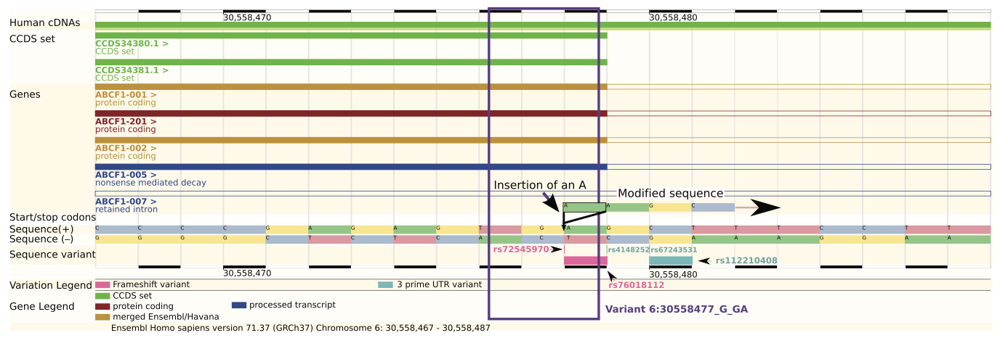

<div style="font-size:0.82em; margin-top:0.3em; line-height:1.6;">
rs72545970: ANNOVAR → <span style="color:#E69F00; font-weight:600;">frameshift_insertion</span> · VEP → <span style="color:#E69F00; font-weight:600;">stop_loss</span><br>
Precise SO definitions give tools a single agreed-upon term for each event
</div>

<small>PMID: 24944579</small>

</div>
</div>

Note: Sequence Ontology (SO) is an open community ontology providing a controlled vocabulary for molecular variant consequences. Before its wide adoption, tools used inconsistent terminology — "nonsense" vs "stop_gained", "splice-site" vs "splice_donor_variant" — making cross-tool comparisons and database integration difficult. The variant rs72545970 illustrates the problem: a single-base insertion at the penultimate position of an exon. It shifts the reading frame (ANNOVAR → frameshift_insertion) but also alters the stop codon context (VEP → stop_loss). Neither answer is obviously wrong — the ambiguity arises from overlapping molecular consequences at one position. SO terms are hierarchically organized (frameshift_variant is a child of protein_altering_variant), so a query for "protein-altering variants" automatically captures stop_gained, frameshift, missense, and splice_donor variants at the right level of specificity. VEP, ANNOVAR, SnpEff, and ClinVar all output SO terms, making cross-database comparisons tractable.

---

## Additional Context: Pedigree, Phenotypes, …

All three panels describe the same patient and the same candidate variant

<div class="r-stretch" style="display:flex; gap:1.2em; align-items:stretch;">

<div style="flex:1; display:flex; flex-direction:column; gap:0.5em;">
<p style="margin:0; font-size:0.75em; font-weight:700; color:#E69F00; text-align:center;">Inheritance Pattern</p>
<svg viewBox="0 0 160 130" xmlns="http://www.w3.org/2000/svg" style="flex:1; min-height:0;">
  <rect x="20" y="10" width="30" height="30" fill="none" stroke="rgba(255,255,255,0.8)" stroke-width="2"/>
  <circle cx="120" cy="25" r="15" fill="none" stroke="rgba(255,255,255,0.8)" stroke-width="2"/>
  <circle cx="120" cy="25" r="5" fill="rgba(255,255,255,0.8)"/>
  <line x1="50" y1="25" x2="105" y2="25" stroke="rgba(255,255,255,0.5)" stroke-width="1.5"/>
  <line x1="80" y1="25" x2="80" y2="75" stroke="rgba(255,255,255,0.5)" stroke-width="1.5"/>
  <rect x="65" y="75" width="30" height="30" fill="rgba(255,255,255,0.85)" stroke="rgba(255,255,255,0.8)" stroke-width="2"/>
  <text x="35" y="58" text-anchor="middle" font-size="9" fill="rgba(255,255,255,0.6)">A/A</text>
  <text x="120" y="58" text-anchor="middle" font-size="9" fill="rgba(255,255,255,0.6)">A/G</text>
  <text x="80" y="122" text-anchor="middle" font-size="9" fill="rgba(255,255,255,0.6)">A/G</text>
  <text x="80" y="108" text-anchor="middle" font-size="8" fill="rgba(255,255,255,0.9)">affected</text>
</svg>
<p style="margin:0; font-size:0.65em; text-align:center; opacity:0.65;">De novo? Inherited from which parent?</p>
</div>

<div style="flex:1; display:flex; flex-direction:column; gap:0.5em;">
<p style="margin:0; font-size:0.75em; font-weight:700; color:#0072B2; text-align:center;">Clinical Phenotype (HPO)</p>
<div style="flex:1; display:flex; flex-direction:column; justify-content:center; gap:0.4em; font-size:0.7em; padding:0.4em;">
  <div style="background:rgba(0,114,178,0.15); border-left:2px solid #0072B2; padding:0.3em 0.5em; border-radius:0 4px 4px 0;"><b>HP:0001250</b> — Seizures</div>
  <div style="background:rgba(0,114,178,0.15); border-left:2px solid #0072B2; padding:0.3em 0.5em; border-radius:0 4px 4px 0;"><b>HP:0001263</b> — Global developmental delay</div>
  <div style="background:rgba(0,114,178,0.15); border-left:2px solid #0072B2; padding:0.3em 0.5em; border-radius:0 4px 4px 0;"><b>HP:0000252</b> — Microcephaly</div>
</div>
<p style="margin:0; font-size:0.65em; text-align:center; opacity:0.65;">Does it match the gene's known disease spectrum?</p>
</div>

<div style="flex:1; display:flex; flex-direction:column; gap:0.5em;">
<p style="margin:0; font-size:0.75em; font-weight:700; color:#009E73; text-align:center;">Population Frequency (gnomAD)</p>
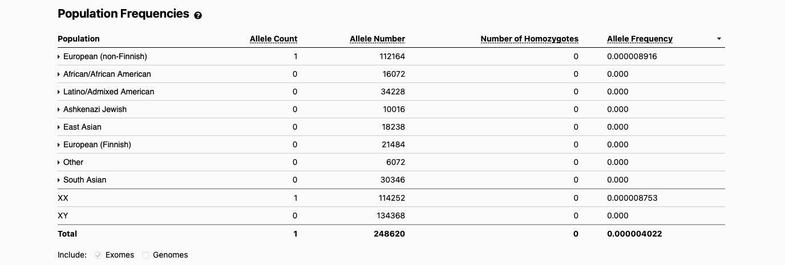
<p style="margin:0; font-size:0.65em; text-align:center; opacity:0.65;">Ancestry-stratified AF — absent in all populations here</p>
</div>

</div>

Note: Genomic annotation alone is not sufficient for clinical interpretation. Three additional types of context are essential. (1) Pedigree: is the variant de novo (absent in both parents — strong evidence for pathogenicity) or inherited? If inherited, from the affected or unaffected parent? Autosomal dominant variants should co-segregate with disease. (2) Phenotype: the Human Phenotype Ontology (HPO) provides a standardized vocabulary of >13,000 terms (e.g., HP:0001250 Seizures) to encode clinical features in computable form. Tools like Phenomizer and GADO rank candidate genes by how well their known disease spectrum matches the patient's HPO profile. (3) Population frequency: gnomAD's ancestry-stratified AF table (shown) demonstrates that this variant is absent in all populations — a single carrier in European non-Finnish out of >112,000 alleles (AF ~4×10⁻⁶). Rarity across all ancestries supports pathogenicity. The ACMG/AMP framework formalizes how to combine all these evidence types into a five-tier classification.

---

<!-- .slide: style="font-size:0.9em" -->
## Classifying Variant Pathogenicity: ACMG/AMP

Five-tier classification (Richards et al. 2015, PMID: 25741868)

| Class | Meaning |
|---|---|
| **Pathogenic** | Sufficient evidence for causality |
| **Likely Pathogenic** | >90% probability of pathogenicity |
| **VUS** | Uncertain significance — insufficient or conflicting evidence |
| **Likely Benign** | >90% probability of benignity |
| **Benign** | Sufficient evidence against pathogenicity |

Note: The ACMG/AMP framework is the standard used by clinical genetics laboratories worldwide. Classification combines multiple independent lines of evidence — population frequency, computational predictions, functional studies, segregation data, de novo status — to assign one of five tiers. The VUS (variant of uncertain significance) category is the most challenging: it falls disproportionately on variants from underrepresented populations because population databases have less data for those ancestries, making frequency-based evidence weaker.

---

<!-- .slide: style="font-size:0.8em" -->
## ACMG/AMP Evidence Categories

Pathogenicity evidence is graded by strength:

| Evidence type | Strength (pathogenic) | Example |
|---|---|---|
| LoF in haploinsufficient gene | Very Strong (PVS1) | Frameshift in *BRCA1* |
| Functional studies | Strong (PS3) | Cell-based splicing assay |
| De novo (confirmed) | Strong (PS2) | Confirmed absent in parents |
| Low population frequency | Moderate (PM2) | Absent from gnomAD |
| Computational evidence | Supporting (PP3) | CADD ≥ 20, SpliceAI > 0.5 |
| Segregation with disease | Supporting → Strong (PP1) | Co-segregates in family |

Note: A single PVS1 plus one supporting criterion is sufficient to classify a variant as Pathogenic. Evidence types have pathogenic (P) and benign (B) counterparts — for example, BS1 (strong benign) fires when the variant allele frequency exceeds the maximum credible frequency for the disease. The ClinGen Variant Curation Expert Panels (VCEPs) refine these rules for specific genes and diseases, often with stricter thresholds or gene-specific criteria. Importantly, VUS status cannot be resolved by finding the same variant in another patient with the same phenotype alone — independent functional or population evidence is required.

---

<!-- .slide: style="font-size:0.85em" -->
## ACMG/AMP categorical combining rules for variant classification

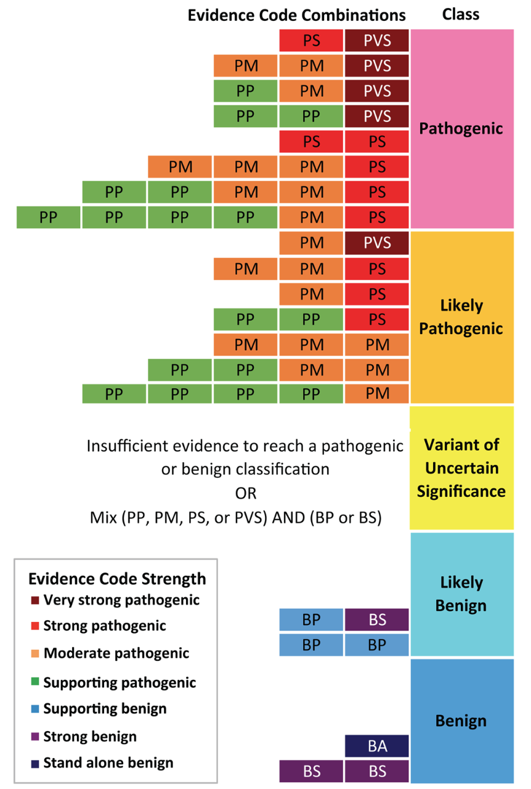

<small>PMID: 30095857</small>

Note: A single PVS1 plus one supporting criterion is sufficient to classify a variant as Pathogenic. 

---

<!-- .slide: style="font-size:0.85em" -->
## Annotation Outputs Drive Variant Filtering

The two parts of this lecture are directly connected:

| Annotation layer | Used in rare variant study as… |
|---|---|
| Functional consequence (SO term) | QV class filter — LoF only? Missense included? |
| Population AF (gnomAD) | Frequency threshold — AF < 0.001? |
| Pathogenicity score (CADD, REVEL) | Per-variant weights $w_j$ in burden / SKAT |
| Gene constraint (pLI, Z-score) | Gene-level filter or analysis priority |
| Clinical databases (ClinVar) | Hard filter or additional evidence tier |

Note: Variant annotation is not just for clinical interpretation — it is the essential preprocessing step before any statistical rare variant analysis. The choice of qualifying variants (QVs) for a gene-based test is determined entirely by annotation outputs: which consequence terms to include, what allele frequency cutoff to use, whether to restrict to LOFTEE high-confidence LoF, and what weights to assign. The weighting step (w_j in burden tests) is also annotation-driven: CADD scores or beta-distribution MAF weights are both derived from annotation. A poor annotation strategy upstream will degrade every downstream statistical test.

---

<!-- .slide: style="font-size:0.85em" -->
## Motivating Example: Rare Variants in *PCSK9*

What does a successful rare variant study look like?

- **Phenotype:** families with extremely low LDL cholesterol
- **Discovery:** sequencing identified LoF variants in *PCSK9* (proprotein convertase)
- **Effect size:** LoF carriers had **88% lower risk** of coronary heart disease (OR ≈ 0.12)
- **Ancestry:** two LoF alleles (p.Y142X and p.C679X) had a combined frequency of ~2.6% in African Americans, rare in Europeans
- **Translation:** directly motivated PCSK9 inhibitors (evolocumab, alirocumab) — FDA approved 2015

**The methods in this section explain how discoveries like this are made**

<small>Cohen et al. 2006 · PMID: 16554528</small>

Note: This case study sets the stage for everything that follows. The PCSK9 story begins with a clinical observation — families with unusually low LDL — and a sequencing-based discovery that identified loss-of-function variants as the cause. The effect size is enormous (88% reduction in CHD risk), far larger than anything found by GWAS for the same trait. This is characteristic of highly penetrant rare variants: they are rare precisely because selection acts against large-effect alleles, or in this case because losing PCSK9 function turns out to be protective. The drug translation is a bonus: evolocumab and alirocumab are now standard of care for high-risk patients. Ask students: what did the researchers need to do this study? They needed (1) a well-phenotyped cohort, (2) enough carriers to detect the signal, (3) functional annotation to recognize the LoF, and (4) population-stratified frequencies to confirm rarity across ancestries. Every method in this part of the lecture addresses one of those needs.

---

## Spectrum of Disease Allele Effects

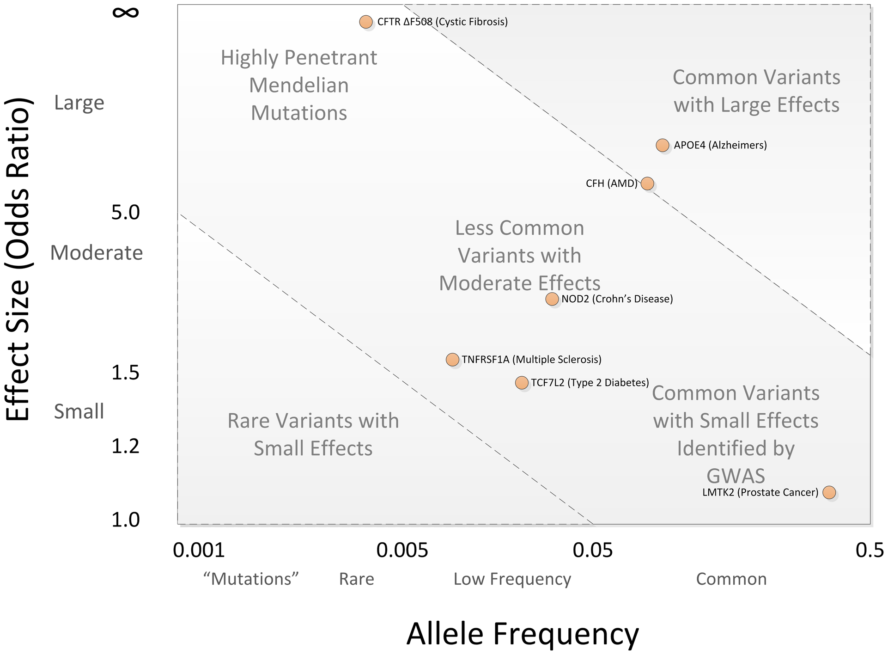

<small>PMID: 23300413</small>

Note: Disease associations are often conceptualized in two dimensions: allele frequency and effect size. Highly penetrant alleles for Mendelian disorders are extremely rare with large effect sizes (upper left), while most GWAS findings involve common SNPs with small effect sizes (lower right). Rare variants with intermediate effect sizes sit in between — too rare to find with GWAS, but potentially discoverable with sequencing-based studies.

---

## If a Disease Phenotype Is Rare, the Causal Variant Should Be Similarly Rare

- A **common variant** cannot cause a **rare disease** — if it did, the disease would be equally common
- Rarity is therefore the **first and most powerful filter** in rare variant analysis
- Rarity is **necessary but not sufficient**: most rare variants are benign background noise
- "How rare is rare enough?" depends on the disease model — the next slides derive a formal threshold ($AF_{max}$)

Note: If a variant causes a phenotype, it should always be rare in every population. Rarity is widely recognized as a necessary (though not sufficient) criterion for variant pathogenicity. The key question becomes "how common is too common?" — a variant present at 1% in the general population is unlikely to cause a rare Mendelian disease affecting 1 in 100,000 people. Note: these figures are from ExAC (Lek et al. 2016, PMID 27535533), which had 60,706 exomes. gnomAD is ExAC's successor and now contains over 125,000 exomes (v2.1) and over 700,000 exomes (v4), with correspondingly lower singleton rates. The principles are the same; the numbers continue to grow.

---

<!-- .slide: style="font-size:0.85em" -->
## How Common Is Too Common?
Penetrant Dominant Mendelian

A causal allele cannot be more common than the disease it causes:

$$AF_{max} = \frac{prevalence \times \text{allelic contribution}}{penetrance}$$

| Parameter | Meaning |
|---|---|
| *prevalence* | Frequency of the disease in the population |
| *allelic contribution* | Max fraction of cases explained by this variant |
| *penetrance* | Probability of disease given the allele |

<small>Whiffin et al. 2017 · PMID: 28518168</small>

Note: For a penetrant dominant Mendelian allele to be disease-causing, it cannot be present in the general population more frequently than the disease it causes. Furthermore, if the disease is genetically heterogeneous, the variant must not be more frequent than the proportion of cases attributable to that single variant. We can define the maximum credible population AF as: AF_max = (prevalence × maximum allelic contribution) / penetrance. This gives a principled frequency threshold for filtering.

---

<!-- .slide: style="font-size:0.85em" -->
## How Common Is Too Common?
Penetrant Recessive Mendelian

Recessive disease requires two alleles — the constraint is looser:

$$AF_{max} = \sqrt{P \times G \times A}$$

$P$ = disease prevalence &nbsp;·&nbsp; $G$ = max genetic contribution &nbsp;·&nbsp; $A$ = max allelic contribution

- Compound heterozygotes (two different rare variants in trans) are included
- Carriers can be **surprisingly common** even for rare recessive diseases
- e.g., CF prevalence ~1/2500 → carrier frequency ~1/25 (Hardy–Weinberg)

<small>Whiffin et al. 2017 · PMID: 28518168</small>

Note: For recessive disease, the frequency constraint is less strict because you need two copies to cause disease. The formula becomes: AF_max = sqrt(prevalence × maximum genetic contribution × maximum allelic contribution). This allows compound heterozygotes (two different rare variants in the same gene) and homozygotes. Note that heterozygous carriers of recessive variants can be surprisingly common even for rare diseases.

---

## The Causal Variant Should Be Rare in All Ancestries

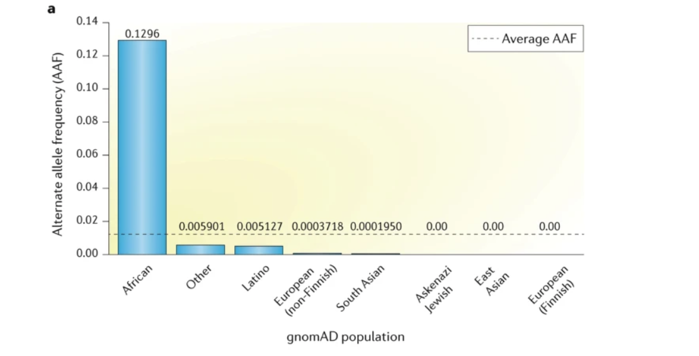

Note: For a particular variant, although the overall allele frequency may be low enough to be a plausible candidate, the allele frequency is often substantially higher in specific sub-populations, casting doubt on its relevance to rare disease. In the example shown, rs79444516 in USH2A (Usher syndrome) is low in European populations but considerably higher in African populations — making it an unlikely cause of a rare Mendelian disease. gnomAD's population-stratified frequencies are essential for this check.

---

## Rare Variant Prioritization: Regional Constraint

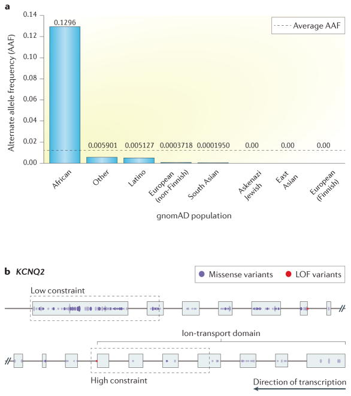

Note: The figure has two panels. Panel (a) repeats the ancestry-stratified AF bar chart from the previous slide — the same variant high in African populations, low in others. The main teaching content here is panel (b): KCNQ2, a voltage-gated potassium channel gene, shown as a gene diagram with missense variants (blue dots) and LoF variants (red dots) plotted along the exon structure. The ion-transport domain (right side of the gene) is visibly depleted of variants — both missense and LoF — relative to the N-terminal region. This is regional constraint: some functional domains within a gene tolerate variation while others do not. A missense variant falling in the ion-transport domain of KCNQ2 is far more likely to be damaging than one in the low-constraint region, even if both would receive a similar CADD score. Tools like MTR (missense tolerance ratio) and regional constraint scores from gnomAD quantify this within-gene variation in tolerance and can be used to weight or filter variants during prioritization.

---

## Filter on Inheritance Pattern

<div class="r-stretch" style="display:flex; align-items:center; justify-content:center;">
<svg viewBox="0 0 800 220" xmlns="http://www.w3.org/2000/svg" style="width:100%; height:100%;">
  <defs>
    <style>
      .uns { fill: none; stroke: rgba(255,255,255,0.85); stroke-width: 2.5; }
      .aff { fill: rgba(255,255,255,0.9); stroke: rgba(255,255,255,0.85); stroke-width: 2.5; }
      .ln  { fill: none; stroke: rgba(255,255,255,0.6); stroke-width: 2; }
      .lbl { fill: rgba(255,255,255,0.9); font-size: 13px; text-anchor: middle; }
      .sub { fill: rgba(255,255,255,0.5); font-size: 10.5px; text-anchor: middle; }
      .leg { fill: rgba(255,255,255,0.55); font-size: 10px; }
    </style>
  </defs>

  <!-- ── Autosomal Dominant ── -->
  <!-- I: Father (affected ■) -->
  <rect x="59" y="39" width="32" height="32" class="aff"/>
  <!-- I: Mother (unaffected ○) -->
  <circle cx="175" cy="55" r="16" class="uns"/>
  <line x1="91" y1="55" x2="159" y2="55" class="ln"/>
  <line x1="125" y1="55" x2="125" y2="100" class="ln"/>
  <line x1="83" y1="100" x2="167" y2="100" class="ln"/>
  <line x1="83" y1="100" x2="83" y2="134" class="ln"/>
  <line x1="167" y1="100" x2="167" y2="134" class="ln"/>
  <!-- II: affected ■ + unaffected ○ -->
  <rect x="67" y="134" width="32" height="32" class="aff"/>
  <circle cx="167" cy="150" r="16" class="uns"/>
  <text x="125" y="188" class="lbl">Autosomal Dominant</text>
  <text x="125" y="202" class="sub">~50% of offspring affected</text>

  <!-- ── Autosomal Recessive ── -->
  <!-- I: Father (carrier ■) -->
  <rect x="326" y="39" width="32" height="32" class="uns"/>
  <circle cx="342" cy="55" r="6" style="fill:rgba(255,255,255,0.85);"/>
  <!-- I: Mother (carrier ○) -->
  <circle cx="458" cy="55" r="16" class="uns"/>
  <circle cx="458" cy="55" r="6" style="fill:rgba(255,255,255,0.85);"/>
  <line x1="358" y1="55" x2="442" y2="55" class="ln"/>
  <line x1="400" y1="55" x2="400" y2="100" class="ln"/>
  <line x1="342" y1="100" x2="458" y2="100" class="ln"/>
  <line x1="342" y1="100" x2="342" y2="134" class="ln"/>
  <line x1="400" y1="100" x2="400" y2="134" class="ln"/>
  <line x1="458" y1="100" x2="458" y2="134" class="ln"/>
  <!-- II: unaffected ■ + affected ○ + unaffected ○ -->
  <rect x="326" y="134" width="32" height="32" class="uns"/>
  <circle cx="400" cy="150" r="16" class="aff"/>
  <circle cx="458" cy="150" r="16" class="uns"/>
  <text x="400" y="188" class="lbl">Autosomal Recessive</text>
  <text x="400" y="202" class="sub">~25% of offspring affected</text>

  <!-- ── De Novo ── -->
  <!-- I: Father (unaffected ■) + Mother (unaffected ○) -->
  <rect x="594" y="39" width="32" height="32" class="uns"/>
  <circle cx="710" cy="55" r="16" class="uns"/>
  <line x1="626" y1="55" x2="694" y2="55" class="ln"/>
  <line x1="660" y1="55" x2="660" y2="134" class="ln"/>
  <!-- II: affected ■ (de novo) -->
  <rect x="644" y="134" width="32" height="32" class="aff"/>
  <text x="660" y="188" class="lbl">De Novo</text>
  <text x="660" y="202" class="sub">New mutation, absent in parents</text>

  <!-- Dividers -->
  <line x1="260" y1="25" x2="260" y2="172" style="fill:none; stroke:rgba(255,255,255,0.18); stroke-width:1; stroke-dasharray:5,4;"/>
  <line x1="535" y1="25" x2="535" y2="172" style="fill:none; stroke:rgba(255,255,255,0.18); stroke-width:1; stroke-dasharray:5,4;"/>

  <!-- Legend -->
  <rect x="95" y="212" width="11" height="11" style="fill:rgba(255,255,255,0.85); stroke:rgba(255,255,255,0.7); stroke-width:1.5;"/>
  <text x="111" y="222" class="leg">Affected</text>
  <rect x="185" y="212" width="11" height="11" style="fill:none; stroke:rgba(255,255,255,0.7); stroke-width:1.5;"/>
  <text x="201" y="222" class="leg">Unaffected</text>
  <rect x="285" y="212" width="11" height="11" style="fill:none; stroke:rgba(255,255,255,0.7); stroke-width:1.5;"/>
  <circle cx="290.5" cy="217.5" r="3.5" style="fill:rgba(255,255,255,0.85);"/>
  <text x="301" y="222" class="leg">Carrier</text>
  <text x="390" y="222" class="leg" style="fill:rgba(255,255,255,0.35);">■ = male  ·  ○ = female</text>
</svg>
</div>

Note: The inheritance pattern, if known from the pedigree, dramatically reduces the search space. For autosomal dominant disease, we look for heterozygous variants absent in unaffected family members. For autosomal recessive, we look for compound heterozygotes (one variant on each parental haplotype) or homozygous variants. X-linked patterns follow hemizygosity rules in males. Filtering to variants consistent with the inheritance pattern can reduce candidate variants from thousands to single digits.

---

<!-- .slide: style="font-size:0.85em" -->
## Prioritize Based on Clinical Phenotypes
Similar genes result in similar phenotypes

<div class="r-stretch" style="display:flex; gap:1.5em; align-items:center;">

<div style="flex:1; display:flex; flex-direction:column; gap:0.5em;">
<p style="margin:0; font-size:0.75em; font-weight:700; color:#E69F00; text-align:center;">Patient HPO profile</p>
<div style="display:flex; flex-direction:column; gap:0.35em; font-size:0.78em;">
  <div style="background:rgba(230,159,0,0.15); border-left:2px solid #E69F00; padding:0.3em 0.5em; border-radius:0 4px 4px 0;"><b>HP:0001250</b> — Seizures</div>
  <div style="background:rgba(230,159,0,0.15); border-left:2px solid #E69F00; padding:0.3em 0.5em; border-radius:0 4px 4px 0;"><b>HP:0001263</b> — Global developmental delay</div>
  <div style="background:rgba(230,159,0,0.15); border-left:2px solid #E69F00; padding:0.3em 0.5em; border-radius:0 4px 4px 0;"><b>HP:0000252</b> — Microcephaly</div>
  <div style="background:rgba(230,159,0,0.15); border-left:2px solid #E69F00; padding:0.3em 0.5em; border-radius:0 4px 4px 0;"><b>HP:0001290</b> — Hypotonia</div>
</div>
<p style="margin:0.5em 0 0; font-size:0.7em; text-align:center; opacity:0.6;">~500 rare variant candidates from exome</p>
</div>

<div style="flex:0 0 auto; display:flex; flex-direction:column; align-items:center; justify-content:center; gap:0.4em; padding:0 0.5em;">
  <span style="font-size:0.72em; color:#009E73; font-weight:700;">Exomiser</span>
  <span style="font-size:1.8em; color:rgba(255,255,255,0.4);">→</span>
  <span style="font-size:0.72em; color:#009E73; font-weight:700;">GADO</span>
</div>

<div style="flex:1; display:flex; flex-direction:column; gap:0.5em;">
<p style="margin:0; font-size:0.75em; font-weight:700; color:#0072B2; text-align:center;">Top-ranked candidates</p>
<table style="width:100%; border-collapse:collapse; font-size:0.78em;">
  <thead>
    <tr>
      <th style="border-bottom:1px solid #444; padding:0.3em 0.5em; text-align:left;">Gene</th>
      <th style="border-bottom:1px solid #444; padding:0.3em 0.5em; text-align:left;">Disease association</th>
    </tr>
  </thead>
  <tbody>
    <tr><td style="padding:0.3em 0.5em;"><em>KCNQ2</em></td><td style="padding:0.3em 0.5em;">Neonatal epileptic encephalopathy</td></tr>
    <tr><td style="padding:0.3em 0.5em;"><em>STXBP1</em></td><td style="padding:0.3em 0.5em;">Ohtahara / West syndrome</td></tr>
    <tr><td style="padding:0.3em 0.5em;"><em>SCN2A</em></td><td style="padding:0.3em 0.5em;">Infantile epileptic encephalopathy</td></tr>
    <tr><td style="padding:0.3em 0.5em;"><em>CDKL5</em></td><td style="padding:0.3em 0.5em;">X-linked epileptic encephalopathy</td></tr>
    <tr style="opacity:0.4;"><td style="padding:0.3em 0.5em;" colspan="2">… 496 genes ranked lower</td></tr>
  </tbody>
</table>
<p style="margin:0.4em 0 0; font-size:0.7em; text-align:center; opacity:0.6;">4 genes flagged for in-depth review</p>
</div>

</div>

Note: The patient's HPO terms encode their clinical presentation in computable form: seizures, global developmental delay, microcephaly, and hypotonia together are characteristic of early-onset epileptic encephalopathy (EOEE). Phenotype-matching tools query curated gene–disease databases (OMIM, Orphanet, HPO annotations) to rank candidate genes by how closely their known disease spectrum overlaps the patient's HPO profile. In this example, KCNQ2, STXBP1, SCN2A, and CDKL5 all rank highly because they are established EOEE genes — each causing a syndrome with seizures and developmental delay as core features. Without phenotype-driven prioritization, a clinical team would review ~500 rare variant candidates; HPO matching narrows this to 4–10 genes, transforming an intractable search into a manageable review. Tools: Exomiser integrates variant pathogenicity scores with phenotype similarity; GADO (PMID 31253775) uses RNA-seq co-expression profiles to predict gene–phenotype relationships; Phenomizer uses OMIM-curated data. Note that this slide uses the same patient HPO profile introduced on the "Additional Context" slide — connecting that clinical setup to the analysis step that uses it.

---

<!-- .slide: style="font-size:0.78em" -->
## Apparent Functional Variants Are Enriched for Error

**LOFTEE** distinguishes high-confidence LoF (HC) from likely artifacts (LC):

| LOFTEE flag | Trigger | Biological reason |
|---|---|---|
| **HC** (high confidence) | Passes all filters | Mid-exon LoF in canonical transcript — likely NMD-degraded |
| **LC** — last exon | Variant in last exon | May escape NMD; truncated protein possible |
| **LC** — non-canonical splice | Splice site not GT-AG | May not disrupt splicing in practice |
| **LC** — minimal exon | Exon < 3 aa encoded | Exon may be alternatively spliced |
| **LC** — low depth | Low total read depth at site | Low genotype confidence; call may be artifact |

- LOFTEE runs as a VEP plugin — not a standalone tool
- gnomAD uses LOFTEE HC for all LoF counts and constraint metrics (pLI)

Note: Not all variants that pass standard quality filters are real. Apparent LoF variants in particular are highly enriched for sequencing and annotation artifacts: misalignment of reads in repetitive regions, reference errors, incorrect transcript models, and sequencing chemistry errors. LOFTEE (Loss-Of-Function Transcript Effect Estimator) was developed by the gnomAD team specifically to flag these cases. An LC (low-confidence) flag does not mean the variant is benign — it means there is increased uncertainty about whether it truly causes LoF. A stop-gain in the last exon is a canonical example: the resulting transcript may escape nonsense-mediated decay (NMD) because the stop codon is not positioned >50–55 nt upstream of the last exon-exon junction, which is the signal that triggers NMD. Always manually inspect candidate variants in IGV before acting on annotation alone.

---

## Many Tools for Prioritization, But Lots of Room for Improvement

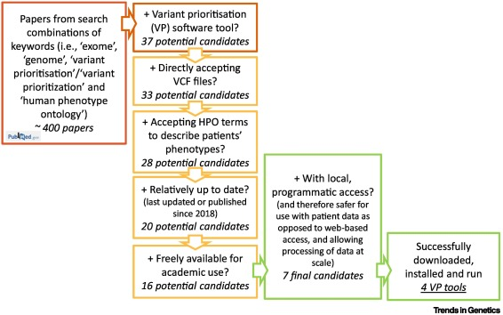

<small>PMID: 35934592</small>

Note: The flowchart (Danis et al. 2022) shows how a systematic review of ~400 papers on variant prioritization tools was narrowed to 4 tools that could actually be downloaded, installed, and run on a test case. Starting from 37 tools that call themselves "variant prioritization software," only 33 accepted VCF input, only 28 accepted HPO terms to describe patient phenotype, only 20 were reasonably up to date (published or updated since 2018), only 16 were freely available for academic use, and only 7 offered local programmatic access (rather than requiring web-based submission of patient data). Of those 7, only 4 could successfully be installed and run. This is the broader landscape of clinical variant prioritization — the field is active and many tools exist, but usability, maintenance, and data privacy requirements filter the practical options to a much smaller set. The pedagogical point: choosing a variant prioritization tool is as much an engineering decision (does it run on your system? accept your data format? update its databases?) as a scientific one.

---

# Part 2: Population-Scale Rare Variant Discovery

Individual variant interpretation → statistical association testing across cohorts

Note: We now shift from individual variant interpretation to population-scale statistical discovery. The same annotation infrastructure — qualifying variant selection, frequency filtering, LOFTEE, pathogenicity scores — underlies both use cases, but the statistical framework changes fundamentally. Rather than ranking candidate variants for one patient, we test every gene in a cohort of thousands to find those where rare variant carriers have significantly different phenotypes.

---

<!-- .slide: style="font-size:0.85em" -->
## Two Use Cases for Rare Variant Analysis

| | Individual Diagnosis | Population Discovery |
|---|---|---|
| **Question** | What caused this patient's disease? | Which genes contribute to disease risk? |
| **Input** | One patient (+ family) | Thousands of cases and controls |
| **Output** | A ranked list of candidate variants | A p-value per gene |
| **Methods** | Annotation, filtering, prioritization | Burden tests, SKAT, SKAT-O |
| **Example** | Mendelian disease workup | PCSK9 and LDL risk |

The previous slides covered **individual prioritization** — the rest of this lecture covers **population-scale statistical discovery**

Note: These two use cases share the same underlying annotation infrastructure but differ fundamentally in their statistical framework. Individual diagnosis is a filtering problem: start with millions of variants, apply annotation-based filters, and rank the handful of survivors. Population discovery is a hypothesis-testing problem: define a test statistic for each gene, compute it across a cohort, and correct for multiple testing. The same variant that is a candidate in a Mendelian workup may be the unit of aggregation in a burden test run on 50,000 individuals. Understanding both use cases is essential for modern biomedical research.

---

<!-- .slide: style="font-size:0.85em" -->
## Study Design: Cases, Controls, and Cohorts

| Design | Who is sequenced | Typical use |
|---|---|---|
| **Case-control** | Cases (affected) + matched controls | Rare Mendelian, rare complex trait |
| **Biobank / cohort** | Population sample; phenotype from records | Multiple traits, population-scale |
| **Family-based (trios)** | Proband + both parents | De novo variants; high penetrance |

- **Goal:** find variants enriched in cases versus controls
- Match on **ancestry, sex, age** — mismatches generate false positives (population stratification)
- Larger N → more power; most rare variant studies are underpowered with N < 1,000

Note: The choice of study design is one of the most consequential decisions in rare variant analysis. Case-control studies are the workhorse: they require careful matching of cases and controls on ancestry (and sometimes age and sex) to prevent population stratification artifacts. Biobank studies (UK Biobank, All of Us, FinnGen) offer very large N but use phenotypes extracted from electronic health records, which introduces phenotype misclassification. Family-based trio designs are highly efficient for de novo variant discovery — the child carries the variant but neither parent does, providing strong prior evidence of pathogenicity — but they require sequencing three individuals per proband. Sample size is the dominant determinant of power for rare variant tests: most published studies with N < 1,000 cases are severely underpowered and should be interpreted cautiously.

---

<!-- .slide: style="font-size:0.85em" -->
## Why Study Rare Variants at Population Scale?

<div class="r-stretch" style="display:flex; flex-direction:column; gap:0.4em;">
  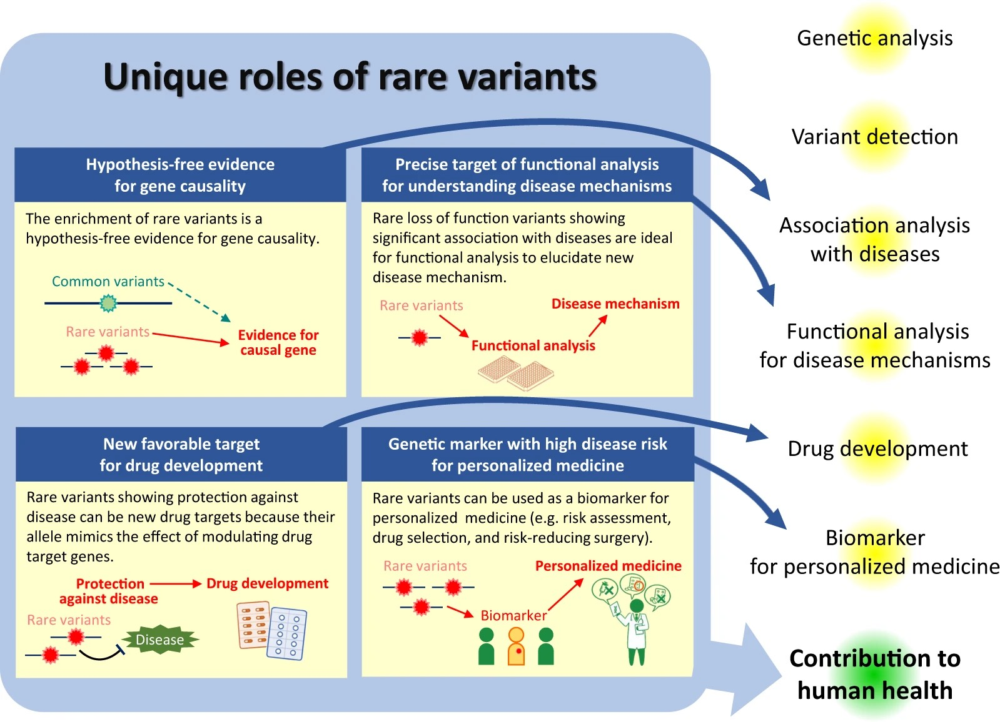
  <p style="margin:0; font-size:0.75em; opacity:0.6;">PMID: 31605095</p>
</div>

Note: The figure summarizes four unique roles of rare variants in population-scale studies. (1) Hypothesis-free evidence for gene causality: enrichment of rare LoF variants in cases implicates a gene without needing a prior hypothesis — unlike candidate gene studies. (2) Target for functional analysis: a rare LoF variant with strong statistical evidence provides a precise molecular handle for dissecting disease mechanisms in cell or animal models. (3) Drug target discovery: rare protective variants that mimic a drug's mechanism of action (e.g., PCSK9 LoF → LDL lowering) validate drug targets cheaply before any compound is made. (4) Personalized medicine: large-effect rare variants can identify individuals at extreme risk or protection, informing screening and treatment decisions. The statistical motivation for aggregating rare variants per gene is simple: no single rare variant (AF < 0.1%) reaches genome-wide significance on its own, but if many variants in the same gene all increase risk, their collective signal in a gene-based test may be detectable. This is the foundation of burden testing, SKAT, and SKAT-O introduced in the next slides.

---

<!-- .slide: style="font-size:0.9em" -->
## Regression Framework

**Common variants (GWAS) — one SNP at a time:**

$$Y = \alpha_0 + \beta G + \boldsymbol{\gamma}^T \mathbf{C} + \varepsilon \qquad G \in \{0,1,2\}$$

**Rare variants — aggregate across a gene:**

$$Y = \alpha_0 + \beta F(G_1, \ldots, G_k) + \boldsymbol{\gamma}^T \mathbf{C} + \varepsilon$$

The choice of aggregation function $F$ defines the test.

$Y$ can be **continuous** (e.g., LDL, BMI) or **binary** (case/control) — the score test framework handles both via the null model.

Note: For common variants (GWAS), we test each SNP individually: Y = α₀ + β·G + γ·C + ε, where G is the genotype (0,1,2 under additive model). For rare variants, individual tests are underpowered because no single variant is common enough. Instead, we aggregate: Y = α₀ + β·F(G₁,G₂,...,Gₖ) + γ·C + ε, where F is some aggregation function over all rare variants in the region. The choice of F defines the test.

---

<!-- .slide: style="font-size:0.9em" -->
## Multiple Testing Correction

Testing one hypothesis per gene across the exome — ~18,000–20,000 genes

$$\text{Exome-wide significance: } p < \frac{0.05}{20{,}000} \approx 2.5 \times 10^{-6}$$

- Less stringent than GWAS ($p < 5 \times 10^{-8}$) — fewer hypotheses tested
- **Bonferroni** is conservative but standard for confirmation
- **FDR** (Benjamini-Hochberg) is used for discovery in exploratory analyses
- Replication in an independent cohort remains the gold standard

Note: When testing ~20,000 genes, we expect ~1,000 false positives at α = 0.05 by chance alone. Bonferroni correction divides the threshold by the number of tests: 0.05/20,000 ≈ 2.5×10⁻⁶. This is more permissive than the GWAS threshold (5×10⁻⁸) because gene-based tests test ~20,000 hypotheses, whereas GWAS tests ~1,000,000 SNPs. Bonferroni is conservative — it assumes all tests are independent, which is not true for overlapping genes or co-regulated gene clusters — but it is the accepted standard for exome-wide significance claims. FDR (Benjamini-Hochberg) controls the expected proportion of false positives among called discoveries; it is more powerful but less commonly used for reporting significant hits. Replication in a fully independent cohort remains the gold standard: a result significant in one study but not replicated should be treated with caution regardless of the p-value threshold used.

---

<!-- .slide: style="font-size:0.85em" -->
## Qualifying Variant Selection

Which variants should I consider? Filter based on:

- Sequencing-based quality metrics
- Variant effect (predicted functional consequence)
- Population allele frequencies — **"rare" = AF < 1% by convention; gene-based tests typically use AF < 0.1% or 0.01%**

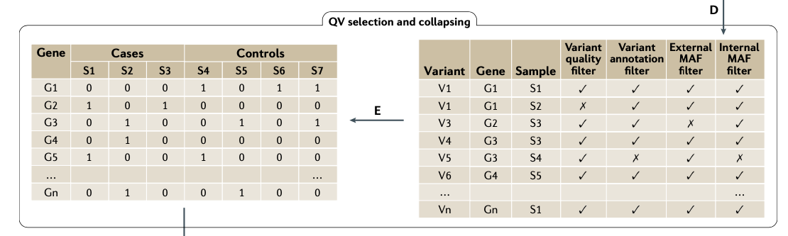

Note: The choice of qualifying variant (QV) criteria has a large impact on power. More restrictive criteria (LoF-only, AF < 0.0001) give higher per-variant enrichment but reduce the number of variants aggregated, potentially missing signal. Less restrictive criteria (all rare nonsynonymous variants) capture more signal but increase background noise. For diseases under strong negative selection, restricting to the rarest variants has shown strong enrichment for causal variants.

---

<!-- .slide: style="font-size:0.9em" -->
## Weighting

$$w_j = \text{Beta}(\text{MAF}_j; a_1 = 1, a_2 = 25)$$

Rarer variants receive higher weight; weight peaks at singletons and declines toward zero as MAF → 0.5.

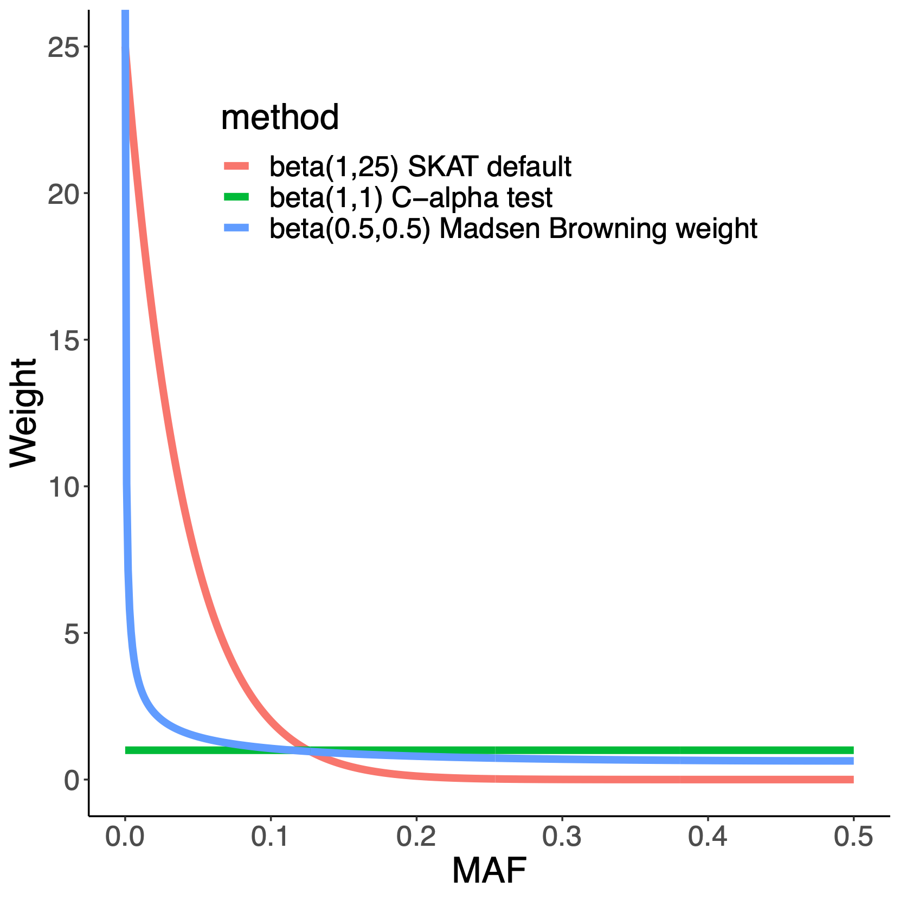

Note: The plot shows three weighting schemes. Beta(1,25) — the SKAT default (red curve) — gives maximum weight to singletons and declines steeply, reaching near zero at MAF ≈ 0.1 and exactly zero at MAF = 0.5. Beta(0.5,0.5) — the Madsen-Browning weight (blue curve) — also peaks at singletons but declines more slowly and stays above zero at higher MAFs; it provides a more uniform upweighting of all rare variants. Beta(1,1) — the C-alpha test weight (green flat line) — gives equal weight to all variants regardless of MAF; this is equivalent to no frequency-based weighting at all. The choice of weighting scheme encodes a prior: Beta(1,25) assumes very rare variants drive disease (strong prior on rarity), while C-alpha assumes all rare variants are equally likely to contribute. Alternative weighting schemes bypass MAF entirely and use predicted functional impact (CADD scores, LOFTEE HC annotation) to assign weights proportional to predicted deleteriousness.

---

<!-- .slide: style="font-size:0.85em" -->
## Choices for the Aggregation Function $F$

| Method | $F(G_1,\ldots,G_k)$ | Captures |
|---|---|---|
| **Collapsing** | $\mathbf{1}\left[\sum_j G_{ij} > 0\right]$ | Binary carrier status — any QV present? |
| **Count** | $\sum_j G_{ij}$ | Number of rare alleles carried |
| **Weighted sum** | $\sum_j w_j G_{ij}$ | Allele frequency or function-weighted burden |

- Collapsing is most powerful under a **dominant, high-penetrance** model
- Count / weighted sum gain power when **multiple rare alleles** per individual are informative
- Weights $w_j$ can encode MAF (rarer = higher) or predicted pathogenicity (CADD, LOFTEE)

Note: The choice of aggregation function F is the central design decision in any rare variant test. Collapsing (binary) is appropriate when one hit is sufficient to cause disease. Count and weighted sum are better when dose matters — e.g., compound heterozygotes or genes where carrying two rare variants confers more risk than one. The weighted sum with beta-distribution MAF weights is the default in SKAT and most modern implementations.

---

<!-- .slide: style="font-size:0.85em" -->
## Population Stratification in Rare Variant Studies

A major source of false positives — and harder to control than in GWAS

- Rare variants are far more **ancestry-specific** than common variants
- A variant rare overall may be polymorphic in one population
- If cases and controls differ in ancestry, that frequency difference produces a **spurious gene-level signal**
- Top-PC correction (standard in GWAS) is **insufficient** — it captures only the largest axes of variation and misses fine-scale structure

Note: Population stratification is more dangerous for rare variant tests than for GWAS because rare variants are far more ancestry-specific — a variant that is rare overall may be polymorphic in one population. If cases are enriched for one ancestry and controls for another, that frequency difference will produce a spurious gene-level signal. Standard GWAS correction with top PCs as covariates captures only the largest axes of variation and misses fine-scale structure.

---

<!-- .slide: style="font-size:0.85em" -->
## Population Stratification: Solutions

| Approach | Method | Notes |
|---|---|---|
| Ancestry matching | Select controls from same ancestry cluster | Gold standard, but limits N |
| Mixed model | SAIGE, REGENIE | Model full kinship matrix; handles biobank scale |
| Within-ancestry analysis | Stratified analyses | Preserves power per stratum |

SAIGE and REGENIE model the full **genetic relationship matrix (GRM)**, accounting for both population structure and sample relatedness simultaneously.

Note: SAIGE and REGENIE were specifically designed for large biobank-scale rare variant studies and model the full genetic relationship matrix (GRM), accounting for both population structure and sample relatedness simultaneously. Ancestry matching is the gold standard when feasible but can severely limit sample size, especially for underrepresented populations. Stratified analysis preserves power per stratum but requires sufficient sample sizes within each ancestry group.

---

<!-- .slide: style="font-size:0.85em" -->
## Burden Tests

Rare variants can't be tested one-at-a-time — too little power per variant. Instead, **aggregate across all rare variants in a gene**.

**Assumption:** all truly associated variants have the **same direction of effect** (all increase risk, or all decrease it)

**Burden score** — a single weighted sum of rare genotypes, used as one predictor in a regression:

$$y = \alpha_0 + \boldsymbol{\alpha}^T \mathbf{C} + \beta \underbrace{(w_1 G_1 + w_2 G_2 + \cdots)}_{\text{burden score}} + \varepsilon$$

**Score statistic** — test $H_0: \beta = 0$

$$Q_{burden} = \left(\sum_j w_j S_j\right)^2, \qquad S_j = \sum_{\text{samples}} G_j (y - \hat{y})$$

$S_j$ measures how strongly variant $j$'s genotype correlates with the phenotype residuals

Note: The burden test works well when all risk variants have the same direction of effect. The complete score statistic is Q_burden = (r̃ᵀ G w)², where r̃ are the residuals from the null model (Y − μ̂), G is the genotype matrix (individuals × variants), and w is the weight vector. The residuals connect the genotype to the phenotype — without them the statistic is a function of genotype alone and cannot test association.

---

<!-- .slide: style="font-size:0.85em" -->
## Burden Tests: When Effects Cancel

The statistic sums contributions **before** squaring — so opposite-direction effects cancel:

- If all variants **increase** risk: $S_j > 0$ for all $j$ → large sum → good power
- If some **increase** and others **decrease** risk: positive and negative $S_j$ cancel → **power loss**

Example — $S_1 = +3$ (risk variant), $S_2 = -3$ (protective variant):

$$Q_{burden} = (+3 + (-3))^2 = \mathbf{0} \qquad \text{— real signal, test sees nothing}$$

**Use burden when** you have prior evidence that variants act in the same direction — e.g., loss-of-function variants in a haploinsufficient gene

Under $H_0$, $Q_{burden}$ follows a chi-squared distribution or can be estimated by permutation

Note: When variants have effects in opposite directions — some increasing risk, some protective — they cancel in the burden sum, and the test has low power. This is a known limitation of burden tests. It can occur in genes that act as tumor suppressors (where LoF increases cancer risk) but also contain common protective variants, or in any gene with functional bidirectional variation.

---

<!-- .slide: style="font-size:0.82em" -->
## Variance-Component Tests

Solve the cancellation problem: **square first, then sum**

$$Q_{SKAT} = \sum_j (w_j S_j)^2 \qquad \text{vs.} \qquad Q_{burden} = \left(\sum_j w_j S_j\right)^2$$

<div style="display:flex; gap:2em; justify-content:center; margin-top:0.5em; font-size:0.88em;">
  <div style="text-align:center; background:rgba(230,159,0,0.12); border:1px solid rgba(230,159,0,0.3); padding:0.4em 1em; border-radius:6px;">
    <div style="opacity:0.65; font-size:0.85em; margin-bottom:0.2em;">Burden — cancels</div>
    <div>$(+3) + (-3) = \mathbf{0}$</div>
  </div>
  <div style="text-align:center; background:rgba(0,158,115,0.12); border:1px solid rgba(0,158,115,0.3); padding:0.4em 1em; border-radius:6px;">
    <div style="opacity:0.65; font-size:0.85em; margin-bottom:0.2em;">SKAT — both contribute</div>
    <div>$(+3)^2 + (-3)^2 = \mathbf{18}$</div>
  </div>
</div>

**Full matrix form:**
$$Q_{SKAT} = \tilde{\mathbf{r}}^T \mathbf{G} \mathbf{W}^2 \mathbf{G}^T \tilde{\mathbf{r}}$$

where $\tilde{\mathbf{r}} = Y - \hat{\mu}(\mathbf{C})$ are residuals from the null model — the genotype predicts what the covariates couldn't

**Trade-off:** when all variants truly go the same direction, burden is more powerful — squaring discards the sign information that burden exploits

Note: SKAT (Sequence Kernel Association Test) solves the main weakness of burden tests: if some variants in a gene increase risk and others are protective, burden tests lose power because the signal cancels in the sum. SKAT avoids this by squaring each per-variant score S_j before summing. In matrix form, Q_SKAT = r̃ᵀ G W² Gᵀ r̃, where r̃ are the null-model residuals, G is the genotype matrix, and W is the diagonal weight matrix. Squaring ensures that a variant with S_j = −3 contributes (−3)² = 9 to the statistic, the same as a variant with S_j = +3. The distribution of Q_SKAT under H₀ follows a mixture of chi-squared distributions, computed from the eigenvalues of a kernel matrix — this is why SKAT requires a dedicated software implementation rather than a standard regression package.

---

<!-- .slide: style="font-size:0.85em" -->
## Burden vs. SKAT

| | Burden | SKAT |
|---|---|---|
| Effect direction assumed | Same | Mixed |
| Statistic | $\left(\sum w_j S_j\right)^2$ | $\sum (w_j S_j)^2$ |
| Power advantage | All same direction | Opposite directions |

Note: SKAT (sequence kernel association test) squares the per-variant score contributions before summing. The full statistic is Q_SKAT = r̃ᵀ G W² Gᵀ r̃, where W is a diagonal weight matrix. Squaring means that effects in opposite directions both contribute positively — unlike burden, they no longer cancel. This makes SKAT more robust when effect directions are mixed. The trade-off: when all variants truly act in the same direction, burden tests are more powerful than SKAT. The SKAT-O test (next slide) addresses this by mixing both approaches.

---

<!-- .slide: style="font-size:0.9em" -->
## Unified Test: SKAT-O

$$Q_{SKAT-O} = (1 - \rho) \cdot Q_{SKAT} + \rho \cdot Q_{burden}$$

- $\rho = 0$: pure SKAT — robust when effects go in opposite directions
- $\rho = 1$: pure burden — most powerful when all variants have the same effect direction
- SKAT-O searches over $\rho \in [0,1]$ and selects the value giving the best $p$-value

Note: SKAT-O (optimal unified test) combines burden and SKAT by searching over a range of ρ values (0 = pure SKAT, 1 = pure burden) and selecting the value that gives the best p-value. This provides robustness across scenarios without requiring prior knowledge of the direction of effects. The p-value accounts for the search over ρ. The downside is reduced biological interpretability — it blurs the initial assumptions about effect direction.

---

<!-- .slide: style="font-size:0.85em" -->
## Burden Methods: Implementation in SKAT

**Step 1 — fit the null model (without genotypes):**
```r
null_model <- SKAT_Null_Model(Y ~ C, out_type = "C")  # "D" for binary; prefer SKATBinary() for case-control
```

**Step 2 — run the association test:**
```r
result <- SKAT(G, null_model)           # variance-component (SKAT)
result <- SKAT(G, null_model, r.corr=1) # burden (r.corr=1 = pure burden)
result <- SKAT_O(G, null_model)         # SKAT-O (optimal unified test)
```

The score statistic uses residuals $\tilde{\mathbf{r}} = Y - \hat{\mu}(\mathbf{C})$ from the null model:

$$Q_{SKAT} = \tilde{\mathbf{r}}^T \mathbf{G} \mathbf{W}^2 \mathbf{G}^T \tilde{\mathbf{r}}$$

Fit the null model **once**, then run for every gene — computationally efficient.

Note: SKAT separates fitting the null model (covariates only) from the gene-level test. This is efficient: fit the null model once, then run SKAT for each gene. out_type="C" for continuous traits (linear model), "D" for binary case-control (use SKATBinary and SKATBinary_Optimal for binary traits). r.corr in SKAT() controls the burden/SKAT mixing: 0 = pure SKAT, 1 = pure burden. SKAT-O is implemented as a separate function SKAT_O() — it is not r.corr="optimal" (that string is not a valid argument and will throw an error). The null model stores the residuals used to compute the score statistic. For large biobank-scale analyses, use SAIGE or REGENIE instead, which extend this framework with mixed-model correction for population structure.

---

<!-- .slide: style="font-size:0.85em" -->
## Other Test Variants

**Adaptive Burden Tests**
- Detect effect direction from data; flip the sign of protective variants before summing
- Avoids the same-direction assumption of standard burden tests
- Permutation required — data-driven sign selection inflates type I error under asymptotic approximation

**Step-Up Test**
- Greedily select the most informative subset: start with the highest-effect variant, add variants while the p-value improves
- More powerful when only a few variants in the gene drive the signal
- Computationally expensive; permutation-based

**In practice:** SKAT-O is the default choice; these are used in candidate gene studies or small-N settings

<small>PMID: 24995866</small>

Note: Many other rare variant methods have been proposed. No single method is universally optimal. SKAT-O provides a good balance of robustness and power for most exome-wide analyses.

---

<!-- .slide: style="font-size:0.85em" -->
## Power in Rare Variant Studies

Rule of thumb: you need **large samples**

| Design | Typical N (cases) | When it works |
|---|---|---|
| Single rare variant (OR = 5, AF = 0.001) | ~10,000 | Only at biobank scale |
| Gene-based burden (5 QVs/gene, OR = 3) | ~2,000–5,000 | Standard exome study |
| Extreme phenotype sampling | ~500–1,000 | Top/bottom 5% of trait |
| Family-based trio (dominant, penetrant) | 50–200 trios | Highly penetrant Mendelian |

Note: Power in rare variant studies is determined by three factors: sample size, effect size (OR), and the cumulative minor allele frequency (cMAF) of qualifying variants in the gene. A single rare variant at AF = 0.001 with OR = 5 requires ~10,000 cases to reach exome-wide significance — that is, even a large effect size is invisible without biobank-scale samples. Gene-based tests help by aggregating many variants, but require that all aggregated variants truly act in the same direction and have meaningful effect sizes. Extreme phenotype sampling (e.g., sequencing individuals with BMI > 40 and < 18) is highly efficient because those extremes are enriched for large-effect rare alleles — an intuition from quantitative genetics. Family-based trios are most efficient for identifying de novo variants in highly penetrant Mendelian disorders, where a single family may provide compelling evidence.

---

## Power in Rare Variant Studies: Strategies

**Strategies to increase power:**
- Restrictive QV filters — higher per-variant enrichment
- Multi-ancestry meta-analysis — variants rare in one population may be common in another
- Functional annotation weighting — CADD, pLI boost signal from likely-damaging variants

Note: Power in rare variant studies is fundamentally limited because each variant is rare — even a large odds ratio gives few observable carriers per gene. The gene-based aggregation strategy helps but does not fully solve the problem. Extreme phenotype sampling is highly efficient: sequencing individuals at the tail of a continuous trait (e.g., BMI extremes, very early-onset disease) enriches for rare causal alleles with large effects. Multi-ancestry meta-analysis is increasingly important: a variant that is a singleton in a European cohort of 10,000 may appear 50 times in a global cohort, providing meaningful power. The field is increasingly relying on national biobanks (UK Biobank, All of Us, FinnGen, BioMe) at 100,000–500,000 scale.

---

<!-- .slide: style="font-size:0.9em" -->
## Key Takeaways: Variant Annotation

- Annotate per transcript; use MANE Select for consistency across tools
- gnomAD provides population AF and constraint metrics (pLI, Z-score) — essential inputs
- ACMG/AMP framework combines frequency, functional, and clinical evidence into 5 tiers
- Tools disagree — Sequence Ontology provides the common vocabulary to resolve conflicts
- Always inspect candidate variants manually (IGV) before acting on annotation alone

---

<!-- .slide: style="font-size:0.9em" -->
## Key Takeaways: Rare Variant Analysis

- Aggregate rare variants per gene to overcome single-variant power limitations
- QV selection (consequence, AF, LOFTEE) defines what enters the test — choose carefully
- Burden (same direction) and SKAT (mixed direction) are complementary — SKAT-O unifies both
- Population stratification is a major confounder; use SAIGE or REGENIE at biobank scale
- Power requires large cohorts; functional weighting and multi-ancestry studies help
